<div align="center">

# Game Asset Management System

**游戏资产管理系统 · 本地优先的游戏内容与媒体生产工作台**

从资产编目、AI 生成、质量检查到人工审核与版本交付，让游戏内容在同一条可追溯的工作流中完成生产。


[快速开始](#快速开始) · [功能特性](#功能特性) · [项目结构](#项目结构) · [文档](#文档)

</div>

## 界面预览

以下截图均于 **2026-10-28** 从本地 Chrome 中运行的当前版本截取，展示 Emperor Simulator 项目的实际数据。点击图片可查看原图。

### 资产制作台

统一浏览角色与关联立绘，在检查器中查看内容、关系和修订。

[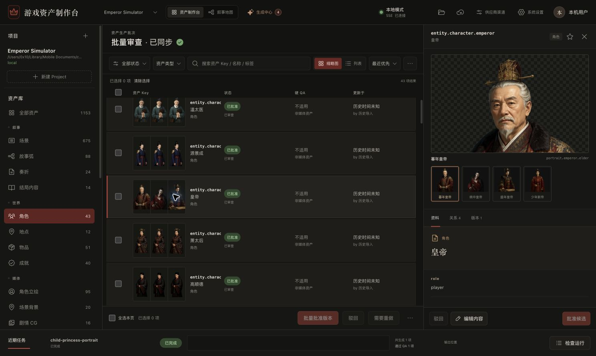](docs/screenshots/workbench.jpg)

### 叙事地图

沿章节与场景浏览剧情，通过关系图谱和覆盖率面板检查资源就绪情况。

[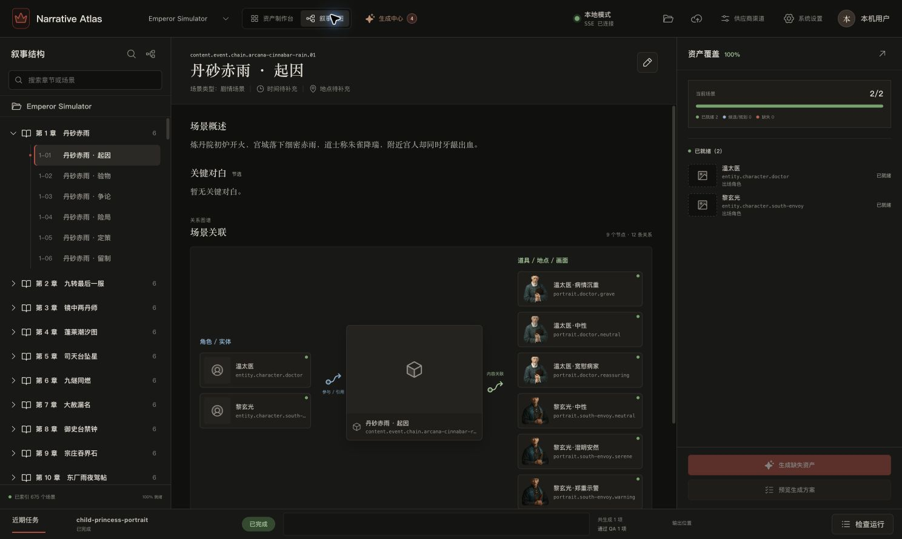](docs/screenshots/narrative-map.jpg)

### 生成中心

在会话中梳理需求，在方案面板中复核资源、任务类型、模型和输出路径。

[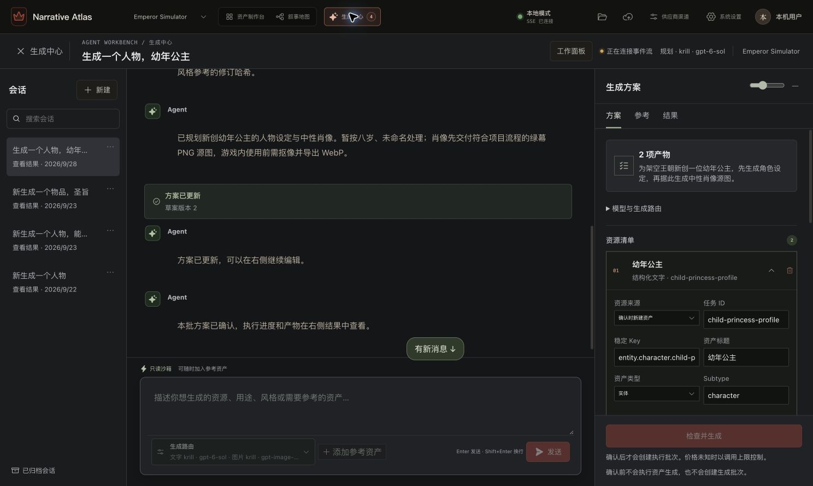](docs/screenshots/generation-plan.jpg)

<details>
<summary><strong>查看生成结果、媒体审核与运行检查器</strong></summary>

#### 生成结果

逐项查看生成与 QA 状态，并进入资产库审核候选。

[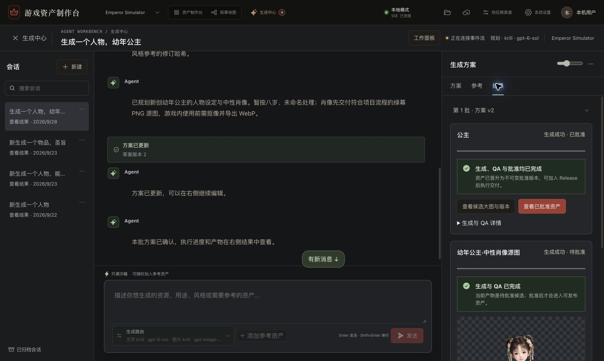](docs/screenshots/generation-results.jpg)

#### 媒体审核

对比候选与已批准修订，查看尺寸、透明通道、主体覆盖率与残余色键等硬 QA 结果。

[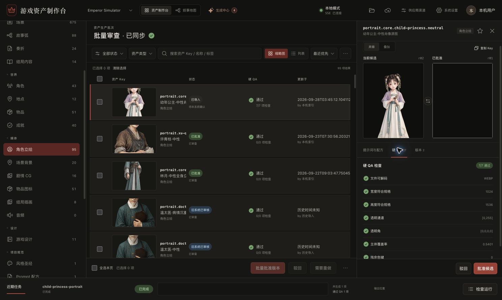](docs/screenshots/media-review.jpg)

#### 运行检查器

检查任务 DAG、调用预算、流水线阶段、Attempt 台账与人工处理入口。

[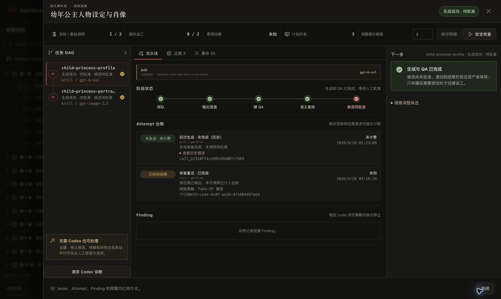](docs/screenshots/run-inspector.jpg)

</details>

<details>
<summary><strong>查看项目规范、供应商渠道与模型管理</strong></summary>

#### 项目规范

将风格圣经等制作规范作为正式资产管理，在检查器中阅读源文档。

[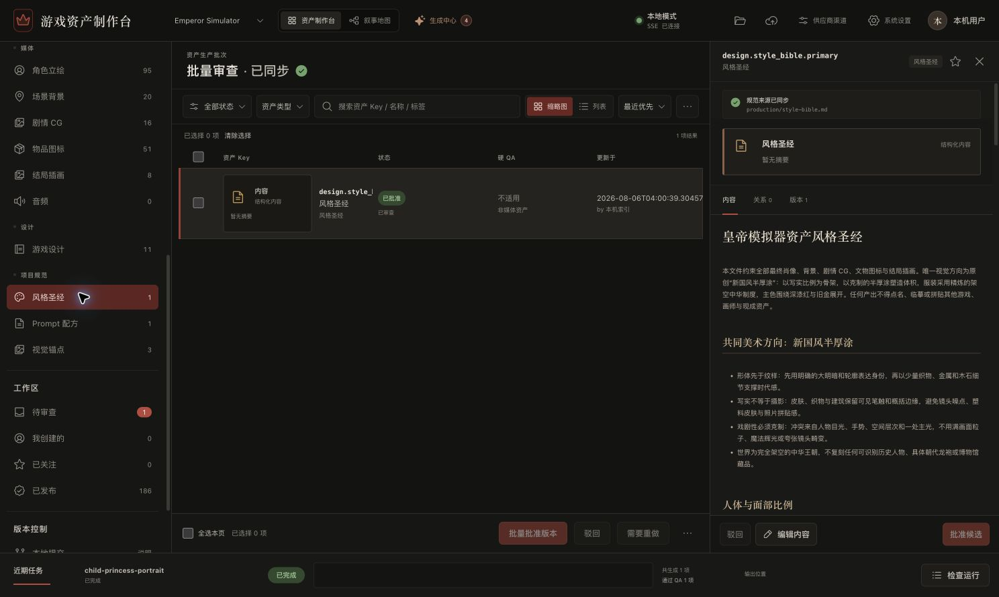](docs/screenshots/project-specifications.jpg)

#### 供应商渠道

集中查看渠道连接状态、模型同步情况与各模态模型数量。

[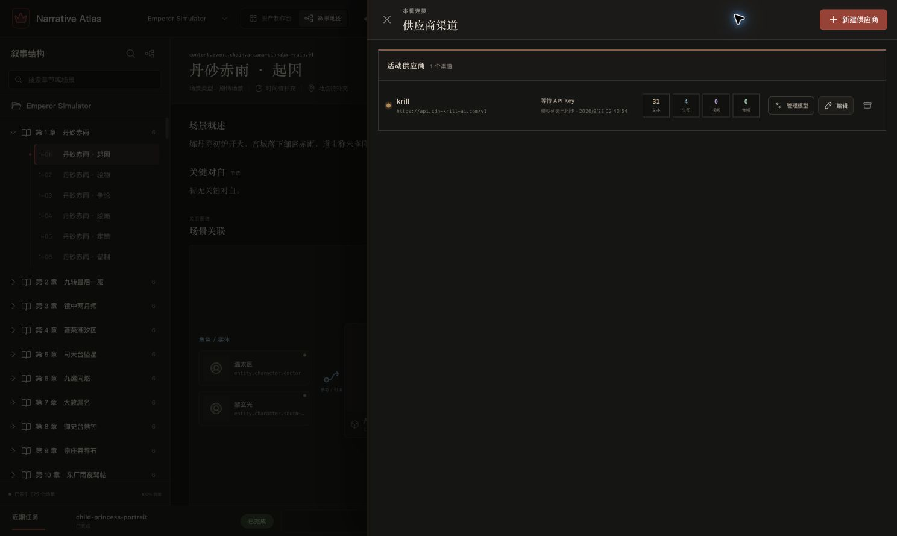](docs/screenshots/provider-channels.jpg)

#### 模型管理

搜索并配置渠道模型白名单，维护模型类型与可用状态。

[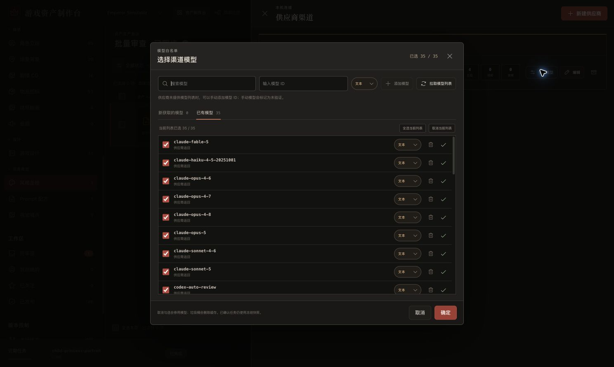](docs/screenshots/model-management.jpg)

</details>

<details>
<summary><strong>查看系统设置与 Release 交付</strong></summary>

#### 系统设置

分别配置文本、生图、视频与音频默认路由，以及新计划并发和网络重试默认值。

[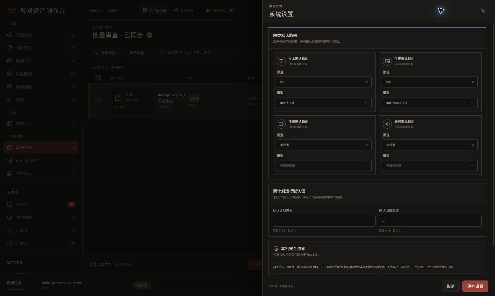](docs/screenshots/system-settings.jpg)

#### Release 与游戏交付

绑定目标 checkout、选择 Release，并查看历史交付收据。截图中保留了试点的历史失败收据，用于展示交付审计界面。

[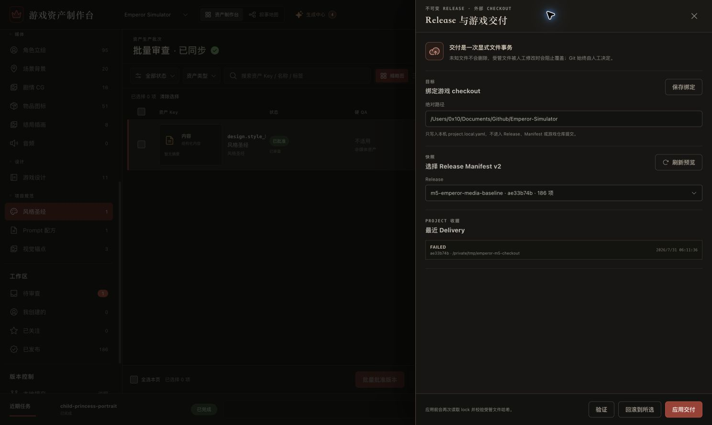](docs/screenshots/release-delivery.jpg)

</details>

## 功能特性

| 能力 | 说明 |
| --- | --- |
| 统一资产库 | 管理叙事、角色、物品、场景与媒体，维护类型化关系和不可变修订。 |
| 生成工作台 | 通过会话整理需求、预览生成计划，确认后执行带依赖关系的任务。 |
| 多供应商路由 | 接入 OpenAI 兼容供应商，分别设置文字和图片模型，支持任务级覆盖。 |
| 可恢复任务 | 冻结 Prompt、模型、预算和并发配置，使用 lease、heartbeat 与持久化 Attempt 恢复执行。 |
| QA 与人工审核 | 检查媒体输出、记录问题与证据，支持修复、重试、重新生成和人工批准。 |
| 叙事地图 | 聚合章节、场景、关联资源与覆盖率，将缺失资源纳入现有生产流程。 |
| 发布与交付 | 从已批准修订创建 Release，预检并交付到指定游戏 checkout，记录交付收据。 |

生成结果需经过 QA 与人工审核才能进入发布流程。已确认任务保留供应商与模型快照，供应商故障不会自动触发跨供应商回退。

## 快速开始

### 环境要求

- Node.js **20+**，以及 npm。
- Python **3.13+**。
- [uv](https://docs.astral.sh/uv/)：Python 依赖与虚拟环境管理工具。
- 默认数据路径按 macOS 配置；其他环境请显式设置项目与状态目录。

### 安装与启动

```bash
git clone https://github.com/PYPARA/Game-Asset-Management-System.git
cd Game-Asset-Management-System

# 安装前端和后端依赖
npm --prefix apps/web ci
uv sync --all-packages

# 同时启动 Web 与 API
npm run dev
```

| 服务 | 本地地址 |
| --- | --- |
| Web 制作台 | http://127.0.0.1:4173 |
| API | http://127.0.0.1:8787 |
| OpenAPI | http://127.0.0.1:8787/openapi.json |

### 首次使用

1. 准备符合下方契约的 Project，并放入项目容器目录。
2. 启动制作台，选择项目并扫描资产。
3. 在供应商设置中配置 Base URL、文字/图片模型和凭据。
4. 创建生成会话，复核计划与预算后执行；审核候选结果，再创建 Release 并交付。

完整流程见[用户操作手册](docs/user-guide.md)。调用生成供应商可能产生费用，请在确认计划前核对模型与预算。

### 自定义数据目录

默认 Project 容器：

```text
~/Library/Mobile Documents/com~apple~CloudDocs/Game-Projects
```

默认本地状态目录：

```text
~/Library/Application Support/Game-Asset-Management-System
```

通过环境变量覆盖默认路径：

```bash
export GAME_ASSETS_PROJECTS_ROOT="$HOME/Game-Projects"
export GAME_ASSETS_STATE_DIR="$HOME/.local/share/game-assets"
npm run dev
```

Project 容器存放多个独立项目；SQLite 保存可重建索引和任务状态。环境变量应在启动 API 前设置。

## 项目结构

```text
Game-Asset-Management-System/
├── apps/
│   ├── web/                 # React + TypeScript + Vite 制作台
│   └── api/                 # FastAPI 服务、数据库迁移与测试
├── packages/
│   └── emperor_adapter/     # Emperor-Simulator 适配器
├── scripts/                 # 开发启动、试点与验收脚本
├── docs/                    # 架构、操作指南与实现文档
├── package.json             # 开发、构建和测试命令
├── pyproject.toml           # uv workspace 配置
└── uv.lock                  # Python 依赖锁文件
```

### Project 数据契约

每个 Project 根目录必须包含 `format_version: 1` 的 `project.yaml`：

```text
My-Game-Project/
├── project.yaml             # 项目声明
├── catalog/                 # 内容、实体、媒体与关系
├── schemas/                 # 项目数据 Schema
├── production/              # 风格、Prompt 与制作母版
├── approved/                # 已批准的运行资源
├── history/                 # 修订、审核、QA 与交付记录
├── releases/                # 不可变发布清单
└── workspace/               # 候选、驳回、缓存与日志（不提交）
```

Project 文件是权威数据源，SQLite 索引可通过扫描重建。项目格式与交付约束见[架构说明](docs/architecture.md)和[Release 与交付](docs/release-delivery.md)。

## 开发与验证

```bash
# 分别启动前端或后端
npm run dev:web
npm run dev:api

# 前端类型检查与生产构建
npm run build

# 全部测试，或仅运行一侧
npm test
npm run test:web
npm run test:api

# M6 离线验收
npm run acceptance:m6
```

`npm run dev:web` 单独运行时使用 Vite 默认端口；`npm run dev` 将 Web 固定在 `4173`。验收范围与历史记录见[M6 发布验收](docs/m6-release.md)；功能进展见[路线图](docs/roadmap.md)。

## 数据管理

- API 仅监听本机回环地址；当前应用以本地工作流为基础。
- 使用 iCloud 时，先确保项目已下载；同一 Project 的写入应在一台 Mac 上进行，文件锁仅在本机生效。
- Project 正式内容、批准媒体与历史记录可由 Git 管理；`workspace/`、`project.local.yaml` 与本地 SQLite 不应提交。
- 浏览器按供应商加密保存 API Key；解锁后的明文仅保存在后端进程内存，不写入 Project、SQLite 或任务事件。
- Release 只包含已批准修订；交付需要明确选择 checkout、Release 与验证动作。
- 应用不会自动提交、推送或修改 Git 历史。

## 文档

| 文档 | 内容 |
| --- | --- |
| [用户操作手册](docs/user-guide.md) | 从首次启动到审核与交付 |
| [系统主逻辑](docs/system-logic.md) | 核心概念与完整工作流 |
| [架构说明](docs/architecture.md) | 数据边界、模块与项目契约 |
| [资产库分类](docs/asset-library.md) | 资产类型与组织方式 |
| [智能生产](docs/agentic-production.md) | 生成计划与监督诊断 |
| [Release 与交付](docs/release-delivery.md) | 发布清单、验证与恢复 |
| [API 说明](apps/api/README.md) | 后端接口与 CLI |
| [故障手册](docs/troubleshooting.md) | 常见问题与恢复方法 |
| [格式升级策略](docs/format-upgrades.md) | 数据格式演进 |
| [路线图](docs/roadmap.md) | 里程碑与验收记录 |
| [M5 试点](docs/m5-pilot.md) · [M6 验收](docs/m6-release.md) · [M7 叙事地图](docs/m7-narrative-map.md) | 分阶段验证与试点记录 |

## 参与开发

欢迎通过 [Issues](https://github.com/PYPARA/Game-Asset-Management-System/issues) 提交问题和功能建议。报告问题时请附上复现步骤、运行环境与脱敏后的错误信息；提交代码前请运行相关测试，并同步更新受影响的文档。
